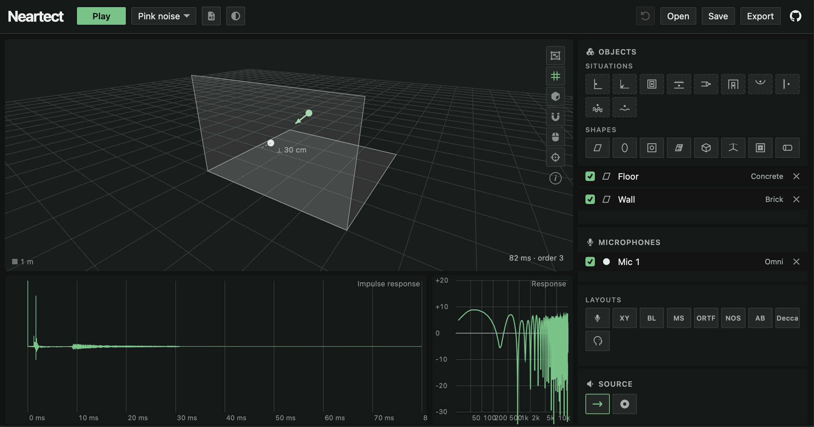

# Neartect: Design the near space

Neartect models how nearby walls, corners, pipes, and gratings colour a
microphone's sound. Place microphones among them, from a millimetre to a few
metres away, give each surface a material, and hear the combs, boundary lift,
corner bass, and resonances they add. Listen live and export impulse responses
or the filtered sound as WAV.

See it live: [**https://janne-s.github.io/Neartect/**](https://janne-s.github.io/Neartect/)



## How it works

Sound arrives as a plane wave from a chosen direction or from a point source.
Build the space from objects, put microphones where they should be, and
listen to a test signal or your own sound through them while you move, bend,
and resize things; the sound follows every change. When it sounds right,
export the space's impulse response for a convolution plugin, or the
processed sound itself.

## Objects

- **Kinds** — Plane, disc, wall with a round or square opening, grating, box,
  corner, niche, and pipe.
- **Material** — From published absorption tables or a porous ground model,
  with a creative strength (1 is physical).
- **Bend** — A plane, wall, or grating bends into an arc about its up or
  across axis, a disc into a bowl or a dome, and a pipe along its length. A
  concave surface gathers its reflection towards its focus, a convex one
  spreads it.
- **Relief** — Waves, arches, scallops, or an egg crate at a set height,
  period, and direction, plus random roughness with a height and grain. Rough
  surfaces lose their coherent treble and scatter it; repeating shapes send
  their own lobes. A speed moves the relief while the preview plays, or in the
  plugin while its window is open (moving water), each new filter gliding in.
- **Gratings** — Bars or slats at a set period, width, and thickness; each bar
  reflects and shades on its own, and fine gratings let bass through.
- **Inside a pipe** — A waveguide: resonances at the end-corrected length, the
  open ends' radiation, the walls' losses, and in wide pipes the cross modes,
  which depend on where across the pipe the microphone sits. The wall's
  material absorbs along the way, roughness damps the cross modes, and rings
  along the axis make a corrugated pipe with its stop bands.
- **Situations** — By a wall, in a corner, in a niche, under a grating, at a
  pipe mouth, in a doorway, by a curved or corrugated wall, over moving waves,
  or over water. A situation adds to the objects already built and keeps the
  microphones and the point source.

## Scene

- **Handles** — Move along east, north, and up, or along the object's own
  axes; resize from the faces; turn and tilt on the rings. Values snap to the
  grid and to 5°; Shift moves freely. On a face, Shift resizes in proportion,
  Alt about the centre, and Cmd or Ctrl freely. The magnet snaps an object's
  sides to other objects.
- **Binding** — A microphone, layout, or point source bound to an object moves
  with it and keeps its gap, along the arc on a bent surface. The target
  button centres it on the object, a wall on its opening.
- **Selecting several** — Drag a rectangle with the area tool, or Shift-click.
  The selection moves and turns as one, with its bound microphones.
- **View** — Scrolling zooms or pans, by choice; a pinch always zooms. A metre
  grid on the ground, with tenths when close.

## Microphones

- **Microphones** — Up to eight, bound to an object or free. Across, gap, and
  up are signed (a negative gap is behind the face or inside the object), from
  1 mm to 5 m. Time and level differences are kept.
- **Patterns** — Omni, wide cardioid, cardioid, supercardioid, hypercardioid,
  or figure of eight, with the proximity effect: a near source or a near
  reflection lifts the bass of a directional pattern.
- **Layouts** — XY, Blumlein, mid-side, ORTF, NOS, spaced pair, Decca tree,
  and a head: the measured KU100 (SADIE II) or a spherical head of adjustable
  width. A layout binds, moves, and turns as one, with its spacing and angle
  adjustable, and switches to another layout in place.

## Source and listening

- **Source** — Far away, as a plane wave from a direction, or a point in the
  scene, bound to an object like a microphone. A point source falls with
  distance from a 1 m reference unless 1/r is off.
- **Signal** — Pink noise, clicks, a sweep, or a sound file, with a
  free-field comparison.
- **Preview** — Microphones spread from left to right; mid-side decodes to
  left and right; a head plays binaurally.
- **Plots** — The near filter and its response relative to the free field.
- **Quality** — Relief detail and an element limit, with lower detail while
  relief moves or something is dragged.

## Export

- **Impulse response** — For a convolution plugin: stereo as heard, or one
  channel per capsule, optionally peak-normalised.
- **Filtered signal** — Stereo as heard, or one channel per capsule.

Audio is 32-bit float WAV. The filter is normalised to the free field. Save
writes the space as JSON.

## Model

Every part of the model is marked with a class that says how far it can be
trusted:

- **A** — Derived from first principles.
- **B** — An approximation from the literature, valid in the range its source
  gives.
- **C** — A heuristic or synthetic assumption, chosen to behave plausibly
  rather than derived or measured.

B/C marks a part that combines the two.

| Part | Model | Class |
|---|---|---|
| Specular reflection, rigid surfaces | image sources, plane wave and point source | A |
| Absorption | published tables, porous ground model | B |
| Finite size, higher orders | high-pass by surface size | B |
| Small panel at low frequencies | edge correction, exact in its limits (Lamb's disc), interpolated between | C |
| Bent surface, first order | Kirchhoff on the arc or sphere | B |
| Bent surface, higher orders | specular points with ray-tube gain, limited near a focus | B/C |
| Pipe interior | waveguide with end correction, radiation, wall losses, cross modes | B |
| Pipe wall | lined-duct mode from the material; corrugation as a radius profile | B |
| Rough pipe wall | larger wall losses, Eckart loss of the cross modes | C |
| Bent pipe | Cummings' equivalent rectangular bend; cross modes as straight | B/C |
| Pipe mouth | cross-mode coupling, blend between outside and inside | C |
| Reflection behind a screen | surface lit as if the screen were not there, the screen's Kirchhoff shadow of the reflected sound | B |
| Grating at low frequencies | blend | C |
| Joined edges, not at right angles | continued edges | C |
| Heads | KU100 minimum-phase with interpolated delays; Brown & Duda sphere | B |
| Strength | creative scaling | C |

Not modelled: the capsule's own size, room modes of closed small spaces,
diffraction into the shadow beyond the Kirchhoff approximation, shadowed
reflections of order two and higher,
angle-dependent absorption, surface vibration, and paths over two bent
surfaces.

Neartect is a creative tool. Where published models exist it follows them,
but a result is a plausible sound, not a measurement.

## Running locally

```sh
npm start
```

Open http://localhost:8003/. Run the JavaScript tests with `npm test` and the
Rust core tests with `npm run test:core`. `npm run build:core` rebuilds
`src/core/` (Rust with the `wasm32-unknown-unknown` target, `wasm-bindgen`,
and Binaryen's `wasm-opt`). `node tools/bench.mjs` times the core over the
situations.

## Data

Absorption coefficients: RoomTreat, CC BY 4.0. Measured head: SADIE II (KU100),
© 2018 University of York, Apache License 2.0; the derived table is in
`core/data/` with its license (Armstrong et al. 2018, Applied Sciences 8(11),
2029).

## Third-party code

Icons are [Font Awesome Free](https://fontawesome.com) 7.3.1, solid style:
font under the SIL OFL 1.1, CSS under the MIT License, icons under CC BY 4.0
([license](assets/vendor/fontawesome/LICENSE.txt)).

## License

MIT

## Support Neartect

Support development through [GitHub Sponsors](https://github.com/sponsors/janne-s)
or [Ko-fi](https://ko-fi.com/jannesarkela). See
[Sanara Creations](https://www.sanaracreations.fi/) for related work.
